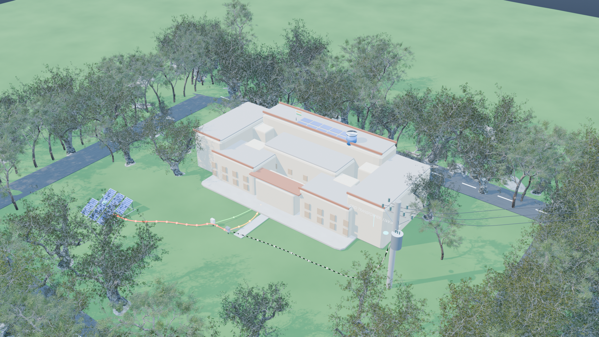
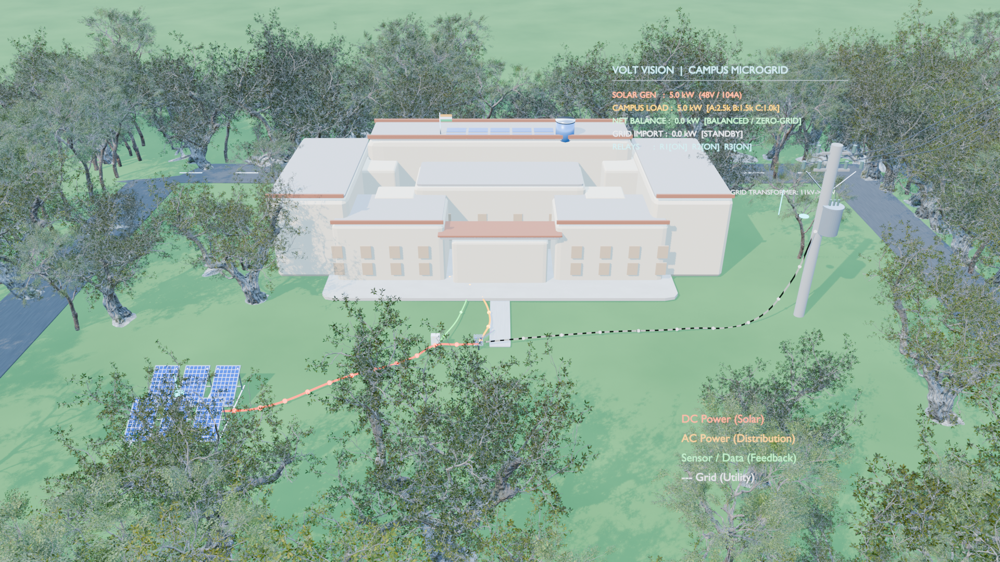

# pbl — Volt Vision

Blender-based 3D campus simulation and solar management render pipeline.

## Screenshots

### Angled campus preview


### Top-down view


## About

Volt Vision is a campus energy simulation rendered in Blender. It models solar power flow across a campus layout, with day/night scenarios, surplus/deficit visualization, and hardware upgrade states.

## Features

- Campus scene modeling in Blender (`.blend`)
- Solar management scenarios (sufficiency, deficit, surplus, night shed)
- Top-down and angled camera views
- Render animation pipeline (`render_volt_vision_animation.py`, `create_volt_vision_video.py`)
- Scene upgrade utilities (hardware units, trees, UI cards)

## Project Structure

```
pbl/
├── solar_management.blend          # Main Blender scene
├── solar_management_1080p.mp4      # Rendered video
├── render_all_scenarios.py         # Render all scenario views
├── render_volt_vision_animation.py # Animation render
├── create_volt_vision_video.py     # Video assembly
├── render_presentation_views.py    # Presentation stills
├── beautify_scene.py               # Scene cleanup
├── volt_vision_blender/            # Blender Python module
│   ├── render_solar_management.py
│   ├── render_stills.py
│   ├── volt_vision_scene.py
│   └── ...
├── main_render/renders/            # Render outputs
│   ├── angled_campus_preview.png
│   └── test_top_down_f2400.png
└── RENDER_RESUME.md                # Render resume notes
```

## Requirements

- Blender (for `.blend` scene editing and rendering)
- Python 3 (for render automation scripts)

## License

MIT
